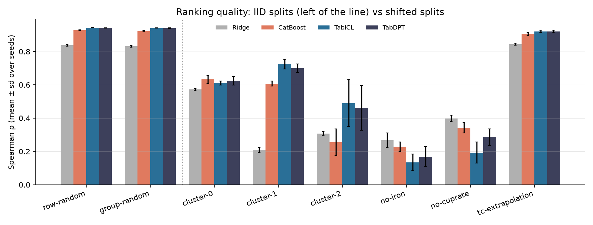
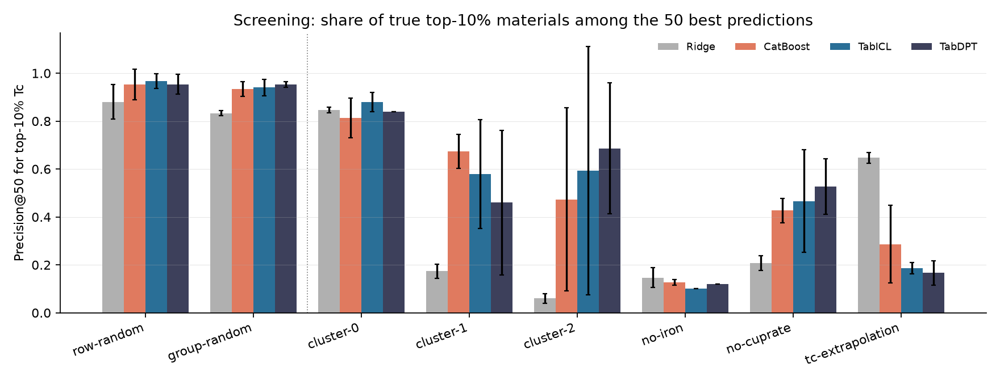

# tabular-shift

**Do tabular foundation models (TFMs) keep their edge over gradient boosting when test materials
differ from training ones — and can any model screen for superconductors hotter than everything
it was trained on?**

A pilot for inverse materials design: TabICL and TabDPT (in-context TFMs, no fine-tuning) against
CatBoost and Ridge on predicting the critical temperature Tc of 21 263 superconductors, under eight
train/test splits from IID to strong shift. 96 runs, 3 seeds, CPU only.

## TL;DR

- **IID: TFMs win.** On a random split by formula, TabICL and TabDPT rank materials better than
  CatBoost (Spearman ρ 0.941 / 0.940 vs 0.923) with 3000 training rows and zero tuning.
- **Under shift the edge is unstable.** TFMs win on two of three held-out feature clusters (up to
  ρ 0.73 vs 0.61), lose on held-out iron-based superconductors (0.14–0.17 vs 0.23 for CatBoost) and
  on held-out cuprates (0.19–0.29 vs 0.34) — where Ridge is best of all (0.40). Which model is best
  depends on *which* shift.
- **No model predicts beyond what it has seen.** Trained only on materials with Tc ≤ 74 K, every
  model — linear included — keeps its predictions at or below 74 K.
- **But at the top of the ranking the linear model wins by 2–4×.** Among each model's 50 best
  candidates, the share of true top-10% materials is 0.65 for Ridge vs 0.29 for CatBoost and
  0.17–0.19 for the TFMs. For screening beyond the training range, the flexible models' ordering
  of the top candidates is the weak spot — exactly where inverse design needs it.
- **Duplicate formulas barely matter here.** 27% of rows repeat a formula, yet a leaky row split
  inflates ρ by at most 0.006 over a grouped split at this sample size — a negative result.




## Setup

- **Data:** UCI Superconductivity (Hamidieh, 2018) — 81 features computed from elemental
  properties, chemical formula, Tc. Families: cuprates (Cu + O, 10 532 rows), iron-based (Fe with
  As / Se / P, 1 732), other.
- **Splits** ([`src/tshift/splits.py`](src/tshift/splits.py)), all but one grouped by formula:

  | Split | Train | Test |
  |---|---|---|
  | `row-random` | random rows (leaky: formulas repeat across sides) | random rows |
  | `group-random` | random formulas | other formulas |
  | `cluster-k` | all KMeans(8) clusters but *k* | cluster *k* |
  | `no-iron` / `no-cuprate` | everything but the family | the family |
  | `tc-extrapolation` | formulas with max Tc ≤ 74 K (80th percentile) | held-out formulas, full Tc range |

- **Models:** TabICL 2.2 and TabDPT 1.3 with default settings on CPU; CatBoost (1000 iterations);
  Ridge with CV-chosen penalty. TabPFN was left out because its weights require a vendor login.
- **Budget:** 3000 training rows (a typical TFM context), up to 2000 test rows, seeds 0–2.
- **Metrics:** RMSE, Spearman ρ, precision@50 for the test pool's top-10% Tc, and for
  `tc-extrapolation` the share of the top 50 predictions above the 74 K training ceiling.
- **Predictions were fixed before the run** ([PLAN.md](PLAN.md)).

## Results (mean over 3 seeds)

| Split | Ridge ρ | CatBoost ρ | TabICL ρ | TabDPT ρ |
|---|---|---|---|---|
| row-random (leaky) | 0.837 | 0.929 | **0.943** | 0.942 |
| group-random | 0.831 | 0.923 | **0.941** | 0.940 |
| cluster-0 | 0.572 | **0.633** | 0.611 | 0.624 |
| cluster-1 | 0.209 | 0.608 | **0.725** | 0.699 |
| cluster-2 | 0.308 | 0.255 | **0.490** | 0.462 |
| no-iron | **0.267** | 0.228 | 0.135 | 0.168 |
| no-cuprate | **0.399** | 0.342 | 0.193 | 0.286 |
| tc-extrapolation | 0.844 | 0.906 | **0.921** | 0.920 |

| `tc-extrapolation` | Ridge | CatBoost | TabICL | TabDPT |
|---|---|---|---|---|
| Max prediction (training ceiling 74 K) | 66.6 | 74.0 | 69.3 | 67.2 |
| Precision@50, top-10% Tc | **0.65** | 0.29 | 0.19 | 0.17 |
| Share of top 50 above 74 K | 0.75 | **0.80** | 0.76 | 0.69 |

Full table with standard deviations: [`results/summary.csv`](results/summary.csv); every run:
[`results/raw.csv`](results/raw.csv).

### Against the predictions

| Prediction (fixed in advance) | Outcome |
|---|---|
| The leaky row split inflates every model's score | ❌ ≤ 0.006 in ρ |
| TFMs ≥ CatBoost IID; the edge shrinks or vanishes under family shift | ✅ |
| Trees cannot predict above the training maximum; discovery is well below ideal | ✅ for every model, not only trees |

## What this suggests for inverse design with TFMs

1. Report results per shift type, not as one "OOD" number: the ranking of models flips between
   cluster, family and target-range shifts.
2. For screening beyond the training range, judge models by how they order the very top
   candidates, not by global ρ — the TFMs here have the best ρ and the worst top-tail precision.
3. A cheap linear baseline belongs in every such benchmark.

## Limitations

One dataset with hand-crafted features, 3000-row context, three seeds, default hyper-parameters,
no uncertainty estimates yet. Screening here is one-shot ranking of a fixed pool, not an
optimisation loop that can exploit model errors.

## Reproduce

```bash
uv sync
uv run pytest
# data: https://archive.ics.uci.edu/dataset/464/superconductivty+data → data/raw/{train,unique_m}.csv
uv run python scripts/run_benchmark.py
uv run python scripts/analyze.py
```
